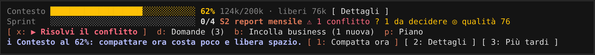
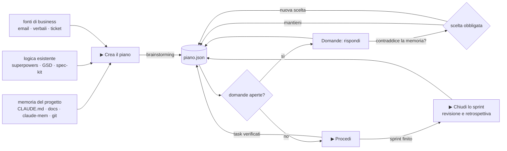
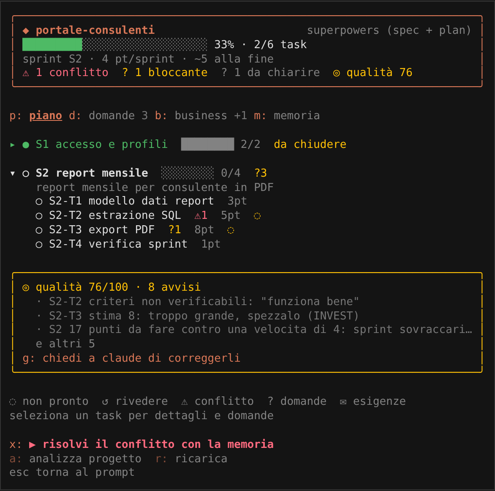
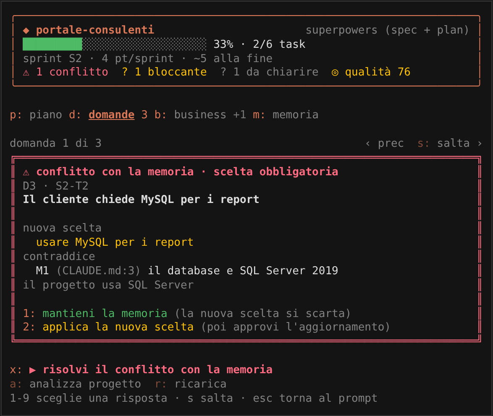
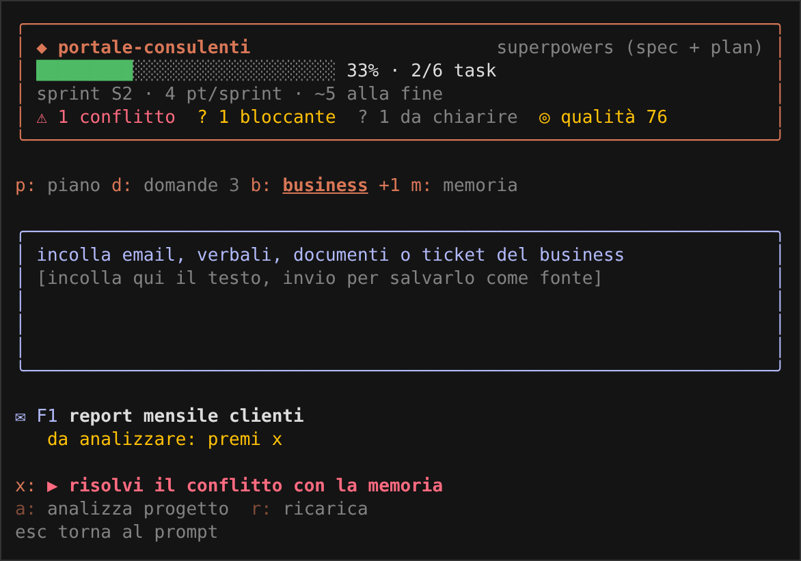
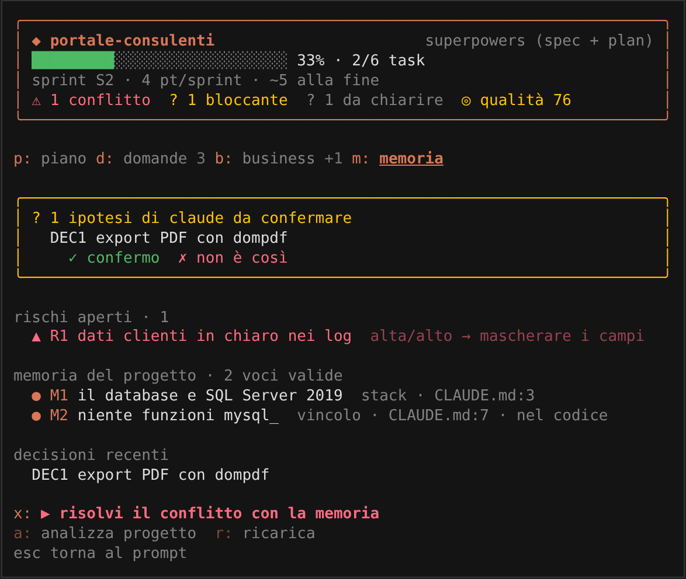

# gestione-sprint · mod per Claude Code

> Dal progetto e dalle richieste del business a un piano sprint completo, che Claude porta avanti **in autonomia e in sicurezza**, consumando meno contesto.
> Tutto con i pulsanti sopra il prompt: nessun comando da ricordare.

    



<sub>La banda del mod sopra il prompt: contesto, sprint corrente, azione consigliata, pulsanti.</sub>

---

## Indice

- [Perché esiste](#perché-esiste)
- [Cosa fa, in breve](#cosa-fa-in-breve)
- [Avvio rapido](#avvio-rapido)
- [Uso con i pulsanti](#uso-con-i-pulsanti)
- [Come funziona](#come-funziona)
- [Il pannello](#il-pannello)
- [claude-mem: la memoria tra le sessioni](#claude-mem-la-memoria-tra-le-sessioni)
- [Due memorie che si controllano a vicenda](#due-memorie-che-si-controllano-a-vicenda)
- [Metodo di project management](#metodo-di-project-management)
- [Come il mod scopre una memoria che si rompe](#come-il-mod-scopre-una-memoria-che-si-rompe)
- [Regole di sicurezza](#regole-di-sicurezza)
- [Installazione](#installazione)
- [Aggiornare e disinstallare](#aggiornare-e-disinstallare)
- [Dove salva i dati](#dove-salva-i-dati)
- [Comandi](#comandi)
- [Opzioni](#opzioni)
- [Uso dei token](#uso-dei-token)
- [Documentazione completa](#documentazione-completa)
- [Requisiti e compatibilità](#requisiti-e-compatibilità)
- [Struttura del repository](#struttura-del-repository)
- [Limiti noti](#limiti-noti)
- [Contribuire](#contribuire) · [Sicurezza](#segnalare-un-problema-di-sicurezza) · [Licenza](#licenza)

---

## Perché esiste

Quando Claude lavora da solo su un progetto vero, i problemi tipici sono tre:

| problema | senza il mod | con il mod |
| --- | --- | --- |
| **dubbi non chiariti** | Claude sceglie da solo e lo scopri a codice scritto | ogni dubbio diventa una domanda; il task non parte finché non rispondi |
| **memoria che si rompe** | una risposta o una modifica contraddice CLAUDE.md, le decisioni o il business | il contrasto viene rilevato e **sei obbligato a scegliere** quale versione vale |
| **contesto che si riempie** | output lunghi, file enormi, sessioni che perdono il filo | barra del contesto, output compresso, compattazione verificata |

Il mod parte da ciò che il progetto **ha già**: memoria, piani, metodo in uso.
Non riscrive: importa e migliora.

---

## Cosa fa, in breve

| | |
| --- | --- |
| 🧠 **legge la memoria del progetto** | CLAUDE.md, AGENTS.md, docs, README, git log, claude-mem e i piani già scritti |
| 🧭 **rispetta la logica esistente** | riconosce superpowers, GSD, spec-kit, BMAD, Taskmaster, roadmap e TODO: importa, non riscrive |
| 💡 **brainstorming con superpowers** | usa `superpowers:brainstorming`; se manca, ne propone l'installazione |
| ✉️ **fonti di business** | incolli email, verbali, documenti o ticket: Claude estrae le esigenze e le copre su uno o più sprint |
| ❓ **domande sui task** | ogni dubbio diventa una domanda con opzioni e scelta consigliata; anche tu puoi aggiungerne |
| ⚠️ **protegge la memoria** | se una risposta o una modifica di Claude contraddice memoria, decisioni o esigenze, il mod si ferma e **ti obbliga a scegliere** |
| 🛡️ **regole nel codice** | le regole verificabili (es. "niente mysql_*") bloccano le modifiche al codice che le violano |
| 📐 **metodo di project management** | definition of ready e of done, stime, task INVEST, rischi, ipotesi da confermare, punteggio di qualità del piano |
| ▶️ **esecuzione autonoma** | Claude esegue i task pronti, verifica i criteri, aggiorna lo stato, si ferma sui dubbi |
| 🖱️ **pulsanti sopra il prompt** | il pulsante ▶ mostra sempre la prossima cosa da fare; Domande, Business e Piano aprono la scheda giusta |
| 🪙 **pochi token** | contesto fisso di poche righe, letture mirate, strumenti rari caricati solo su richiesta |
| 📊 **contesto sotto controllo** | barra del contesto, avvisi, compattazione verificata, passaggio a una sessione nuova |
| 🗜️ **output compresso** | stack trace, test superati, log ripetuti ridotti; errori e avvisi restano sempre |
| 🧠 **claude-mem al centro** | la memoria tra le sessioni: Claude la interroga prima dei file, a strati e con pochi risultati; a fine sprint vi salva l'esito. Se manca, il mod ne propone l'installazione |
| 🧬 **stack consapevole** | Laravel (per versione), PHP, Python, LangChain/LangGraph: cartelle escluse, comandi compatti, credenziali protette |

---

## Avvio rapido

```bat
cd C:\Progetti\ModProgetti
install.bat
```

Poi:

1. apri Claude Code nella cartella del tuo progetto;
2. sopra il prompt compare `Sprint  nessun piano per questo progetto  [ ▶ Crea il piano ]`;
3. clicca **▶ Crea il piano**.

Claude legge la memoria, fa il brainstorming e propone sprint e domande.
Da lì in poi segui il pulsante ▶: ti dice sempre cosa fare.

Guida passo passo, con esempi: [docs/guida-utente.md](docs/guida-utente.md).

---

## Uso con i pulsanti

Sopra il prompt c'è sempre la banda del mod:

```
Contesto ███████████████████░░░░░░░░░░░ 62% 124k/200k · liberi 76k  [ Dettagli ]
Sprint   ████████░░░░░░░░░░░░░░░░░░░░░░ 1/4 S2 report mensile  ⚠ 1 conflitto  ? 1 da decidere  ◎ qualità 82
[ ▶ Risolvi il conflitto ]   Domande (3)   Incolla business (1 nuova)   Piano
```

| pulsante | cosa fa |
| --- | --- |
| **▶ azione principale** | cambia da sola: la prossima cosa da fare, in ordine di urgenza |
| **Domande** | apre il pannello sulla prima domanda aperta: rispondi con un tasto o scrivi |
| **Incolla business** | apre la scheda dove incollare email, verbali, documenti |
| **Piano** | apre il pannello con sprint, task e qualità |
| **Dettagli** | apre il pannello del contesto |

Cosa mostra il pulsante ▶, in quest'ordine:

| quando | il pulsante dice | cosa succede al clic |
| --- | --- | --- |
| nessun piano | ▶ Crea il piano | Claude analizza il progetto |
| una risposta contraddice la memoria | ▶ Risolvi il conflitto | si apre la carta del conflitto: `1` o `2` |
| uno sprint è finito | ▶ Chiudi lo sprint S1 | revisione e retrospettiva |
| hai risposto a delle domande | ▶ Invia 2 risposte | Claude aggiorna il piano con le risposte |
| Claude ha fatto 3 o più ipotesi | ▶ Conferma 3 ipotesi | si apre la scheda memoria |
| hai incollato del business | ▶ Analizza 1 fonte | Claude estrae le esigenze e le collega ai task |
| la memoria va aggiornata | ▶ Aggiorna la memoria | Claude applica gli aggiornamenti approvati |
| una domanda blocca il prossimo task | ▶ Rispondi alla domanda | si apre la domanda |
| il prossimo task non è pronto | ▶ Prepara S2-T1 | Claude corregge il piano |
| tutto chiaro | ▶ Procedi da S2-T1 | Claude esegue i task pronti |

Mentre Claude lavora il pulsante ▶ è attenuato: i pulsanti che gli mandano un messaggio aspettano la fine del turno.

Si clicca col mouse.
Da tastiera: `ctrl+x tab` porta il cursore sulla banda, poi `x` azione principale, `d` domande, `b` business, `p` piano.
Sotto le 100 colonne le etichette si accorciano.

---

## Come funziona



1. **Analisi**: legge la memoria, riconosce il metodo già in uso e lancia il brainstorming.
2. **Piano**: sprint piccoli, task con criteri di accettazione, dipendenze, stime ed esigenze coperte.
3. **Domande**: rispondi con un tasto, con testo libero o con "decidi tu".
4. **Coerenza**: ogni risposta viene confrontata con la memoria. Se c'è un contrasto vedi entrambe le versioni e scegli.
5. **Esecuzione**: Claude lavora solo sui task senza dubbi aperti e chiude ogni task con la prova della verifica.
6. **Chiusura**: a sprint finito, revisione dell'obiettivo e retrospettiva con al massimo 3 lezioni.

Dettagli tecnici: [docs/architettura.md](docs/architettura.md).

---

## Il pannello

Si apre con i pulsanti della banda. Quattro schede: piano, domande, business, memoria.

| piano | conflitto con la memoria |
| --- | --- |
|  |  |

| business | memoria |
| --- | --- |
|  |  |

<sub>Immagini disegnate dal test di anteprima con dati di esempio; nel terminale i colori seguono il tuo tema.</sub>

| tasto | cosa fa |
| --- | --- |
| `x` | l'azione più urgente del momento (la stessa del pulsante ▶) |
| `p` `d` `b` `m` | schede piano, domande, business, memoria |
| `1`-`9`, `0` | scegli un'opzione, `0` = decidi tu |
| `s` | salta alla domanda successiva |
| `q` | nel dettaglio di un task: chiedi a Claude i punti aperti |
| `g` | chiedi a Claude di correggere i problemi di qualità del piano |
| `a` | analizza di nuovo il progetto |
| `r` | ricarica il piano dal file |
| `esc` | torna al prompt |

Simboli nelle righe dei task:

| simbolo | significato |
| --- | --- |
| `○` `◐` `●` `■` `·` | da fare, in corso, completato, bloccato, annullato |
| `◌` | non pronto: manca qualcosa della definition of ready |
| `↺` | da rivedere: una regola su cui si basava è stata superata |
| `⚠` | conflitto con la memoria |
| `?` | domande aperte |
| `✉` | esigenze di business coperte |

**Conflitto con la memoria**: compare una carta rossa con la nuova scelta e la voce che contraddice.
Due tasti soltanto: `1` mantieni la memoria, `2` applica la nuova scelta.
Finché non scegli, il task resta bloccato e Claude non tocca il codice.

---

## claude-mem: la memoria tra le sessioni

[claude-mem](https://docs.claude-mem.ai) registra il lavoro di ogni sessione. Il mod lo usa così:

| momento | cosa fa Claude |
| --- | --- |
| analisi | interroga claude-mem **prima** dei file: `search` con pochi risultati (decisioni, lavoro già fatto, problemi aperti), `timeline` solo se serve, `get_observations` una volta sola con gli id scelti |
| ciò che trova | regole in memoria con fonte `claude-mem #id`, decisioni già prese, task già fatti con la prova `claude-mem #id` |
| claude-mem e un file dicono cose diverse | nasce un conflitto: decidi tu |
| esecuzione di un task | cerca prima il lavoro già fatto sul tema del task; file di codice grandi con `smart_outline` e `smart_unfold` |
| domanda su un task | cerca prima la risposta in memoria |
| chiusura dello sprint | salva l'esito con `save_memory`: le sessioni future lo trovano |
| business e qualità | cerca se un'esigenza è già stata discussa o realizzata; stima i task guardando lavori simili |
| regola cambiata | salva "vecchia → nuova" con `save_memory`, così non torna indietro |
| compattazione e passaggio | il riassunto resta corto (il dettaglio è in claude-mem) e il passaggio si salva lì |

Chi vale quando le fonti non coincidono:

| fonte | contiene | vale per |
| --- | --- | --- |
| `piano.json` | piano, regole registrate, decisioni approvate da te | ciò che si fa e come |
| CLAUDE.md e file di memoria | regole del progetto | le regole, finché un conflitto deciso da te non le cambia |
| claude-mem | storia delle sessioni | cosa è stato fatto e perché |

Un'osservazione di claude-mem non cambia mai da sola il piano: se contraddice una decisione più vecchia, nasce una domanda. Quando una regola cambia, Claude lo annota anche in claude-mem, così le sessioni future non riprendono quella superata.

I dati di claude-mem (database, indici, log) sono protetti: si toccano solo con i suoi strumenti. `~/.claude-mem/settings.json` resta modificabile.

Se claude-mem manca:

- `install.bat` lo propone (passo 6);
- il pannello mostra **claude-mem assente** e il pulsante **installa claude-mem**;
- la prima analisi chiede a Claude di proportelo;
- se rifiuti, la scelta resta nel piano e il mod non lo chiede più.

L'opzione `claudeMem` = `spento` disattiva tutto questo.

---

## Due memorie che si controllano a vicenda

| modulo | memoria che tiene | dove vive |
| --- | --- | --- |
| **sprint** | memoria di **progetto**: regole (M), decisioni (DEC), esigenze di business (F-E), piano | `.claude/sprint/piano.json`, nel progetto |
| **contesto** | memoria della **sessione**: le tue richieste in chat, le decisioni prese parlando, il registro del lavoro | nella sessione, sopravvive a compattazioni e ricariche |

| quando | cosa succede |
| --- | --- |
| scrivi in chat qualcosa che contraddice la memoria di progetto ("usa PostgreSQL" e il progetto dice SQL Server) | sopra il prompt compare la contraddizione con i pulsanti per scegliere |
| scegli "vale la più recente" su una regola di progetto | la regola viene superata come dal pannello: aggiornamento della memoria da approvare, task collegati da rivedere |
| scegli in chat su un tema che non è nel piano | la scelta entra nel piano come tua decisione |
| compatti la sessione | il riassunto non copia il piano: riporta sprint corrente, task in corso e domande aperte, poi Claude rilegge il piano |
| prepari il passaggio a una sessione nuova | il riepilogo include lo stato del piano |
| chiudi un task | se il registro del lavoro ha errori aperti, il mod lo segnala prima di dirlo "fatto" |

Un solo modello piccolo (`conflictModel`, predefinito `haiku`) fa tutti i controlli di coerenza.

---

## Metodo di project management

| pratica | come la applica il mod |
| --- | --- |
| **definition of ready** | un task parte solo con criteri, senza domande bloccanti, con dipendenze completate e vincoli validi |
| **definition of done** | un task si chiude solo con la prova della verifica nella nota; DoD comune in `progetto.dod` |
| **INVEST e stime** | stime in punti (1, 2, 3, 5, 8); da 8 in su il mod chiede di spezzare il task |
| **criteri misurabili** | "funziona bene" viene segnalato: servono test, comandi, output attesi |
| **dipendenze** | segnala dipendenze inesistenti, circolari o verso sprint successivi |
| **verifica di sprint** | ogni sprint si chiude con un task di verifica |
| **MoSCoW** | priorità delle esigenze: alta = must, media = should, bassa = could; le must scoperte sono critiche |
| **registro rischi** | probabilità, impatto, mitigazione e task che la realizza; rischi gravi senza mitigazione sono critici |
| **ipotesi** | le scelte che Claude fa da solo sono ipotesi da confermare, non fatti |
| **tracciabilità** | esigenza → task → sprint, e task → voci di memoria su cui si basa |
| **change control** | quando una regola o un'esigenza viene superata, il mod fa l'analisi d'impatto sui task collegati |
| **revisione e retrospettiva** | a sprint completato il mod si ferma: verifica dell'obiettivo, lezioni come memoria, poi "chiuso" |
| **velocità e previsione** | punti completati per sprint e stima degli sprint rimanenti |

Il punteggio di qualità (0-100) è nella banda e in testata del pannello.
Elenco completo dei controlli: [docs/architettura.md](docs/architettura.md#controlli-di-qualità).

---

## Come il mod scopre una memoria che si rompe

| quando | cosa succede |
| --- | --- |
| **rispondi a una domanda** | la risposta viene confrontata con memoria, decisioni ed esigenze; se contraddice: scelta obbligata |
| **Claude modifica il piano** | ogni contenuto nuovo viene confrontato con ciò che c'era; ogni contrasto diventa un conflitto |
| **Claude scrive codice** | le regole con un divieto verificabile bloccano la modifica che le viola |
| **qualcuno cambia CLAUDE.md o i docs** | ogni voce conserva la riga originale (estratto); se sparisce, la voce passa "da verificare" e nasce una domanda bloccante |
| **una regola viene superata** | i task completati che la usavano ricevono una domanda "va adeguato?"; quelli da fare diventano "da rivedere" |
| **un'ipotesi viene respinta** | diventa una domanda e i task collegati vanno rivisti |
| **Claude modifica direttamente un file di memoria** | bloccato, salvo aggiornamenti che hai approvato per quel file |

---

## Regole di sicurezza

- Le **risposte** le dai solo tu: Claude non può scriverle.
- Sprint e task **esistenti** non si rinominano e non si cancellano: si migliorano o si annullano con motivo.
- La **memoria** del progetto (CLAUDE.md, AGENTS.md, `.claude/memory`, `memory-bank`) non si modifica direttamente, né con Edit/Write né da terminale (`>>`, `sed -i`, `tee`, `Set-Content`…): solo per applicare una scelta che hai approvato.
- Un task con domande bloccanti o conflitti **non parte**, e il codice non si tocca.
- `piano.json` e le fonti si modificano solo con gli strumenti del mod.
- I file con credenziali (`.env`, chiavi, file di configurazione con token) non si leggono.

Cosa protegge e cosa no: [SECURITY.md](SECURITY.md).

---

## Installazione

Requisiti: [Claude Code](https://docs.claude.com/en/docs/claude-code) installato e `claude` nel PATH. Non serve essere amministratore.

```bat
git clone <url-del-repository> C:\Progetti\ModProgetti
cd C:\Progetti\ModProgetti
install.bat
```

`install.bat` fa sei passi:

| passo | cosa fa |
| --- | --- |
| 1 verifica | controlla `claude`, i file del mod e la validazione con la tua versione di Claude Code |
| 2 ricerca | trova versioni precedenti di `gestione-sprint`, il vecchio mod `controllo-contesto`, marketplace e copie manuali |
| 3 rimozione | disinstalla i doppioni, toglie i marketplace vecchi, sposta le copie manuali in `%USERPROFILE%\.claude\backup-gestione-sprint\<data>` |
| 4 installazione | registra la cartella come marketplace `mod-progetti` e installa `gestione-sprint` |
| 5 superpowers | se manca, chiede se installarlo |
| 6 claude-mem | se manca e c'è Node 20 o superiore, chiede se installarlo |

Tutto finisce in `install.log`. Con `install.bat /y` risponde sì a tutto.

> Il mod viene letto da questa cartella: non spostarla. Se la sposti, rilancia `install.bat`.

Installazione a mano (anche su macOS e Linux):

```bash
claude plugin marketplace add /percorso/ModProgetti
claude plugin install gestione-sprint@mod-progetti
claude plugin marketplace add obra/superpowers-marketplace
claude plugin install superpowers@superpowers-marketplace
claude plugin marketplace add thedotmack/claude-mem
claude plugin install claude-mem@thedotmack
```

Se l'installazione si ferma: [docs/risoluzione-problemi.md](docs/risoluzione-problemi.md).

---

## Aggiornare e disinstallare

| cosa | come |
| --- | --- |
| aggiornare | `git pull` nella cartella, poi `install.bat` (toglie la versione vecchia e installa la nuova) |
| ricaricare dopo una modifica ai file | `/reload-plugins` in Claude Code |
| disinstallare | `uninstall.bat` |

I piani nei tuoi progetti (`.claude/sprint`) restano sempre.
Cosa cambia tra le versioni: [CHANGELOG.md](CHANGELOG.md).

---

## Dove salva i dati

Tutto dentro il progetto, in `.claude/sprint/`:

```
.claude/sprint/
├── piano.json     fonte di verità: sprint, task, domande, memoria, business, rischi
├── SPRINT.md      vista leggibile, rigenerata a ogni modifica
└── fonti/F1.md    i testi di business incollati
```

Metti la cartella in git: un'altra istanza di Claude, anche con un altro abbonamento, riparte dallo stesso punto.
Formato completo dei dati: [docs/piano-json.md](docs/piano-json.md).

---

## Comandi

Facoltativi: tutto si fa anche con i pulsanti. Restano per chi preferisce scrivere.

| comando | cosa fa |
| --- | --- |
| `/sprint` | apre il pannello |
| `/sprint-analizza [indicazioni]` | analisi completa: memoria, logica esistente, business, brainstorming |
| `/sprint-procedi [n]` | esegue fino a `n` task pronti (default 3) |
| `/sprint-domande` | elenca le domande aperte |
| `/sprint-fonte <testo o file>` | aggiunge una fonte di business (anche un file `.eml`, `.txt`, `.md`) |
| `/sprint-scegli D3 memoria\|nuova` | risolve un conflitto |
| `/sprint-chiudi [S1]` | chiude uno sprint completato con revisione e retrospettiva |
| `/contesto` | pannello del contesto |
| `/peso` | cosa occupa il contesto e cosa fare |
| `/barra` | mostra o nasconde la barra del contesto |
| `/contraddizioni` | controlla subito le contraddizioni (chat e memoria di progetto) |
| `/alleggerisci [cosa conservare]` | compatta la sessione con riassunto verificato |
| `/passaggio` | riepilogo per ripartire in una sessione nuova |
| `/claudemd` | propone un CLAUDE.md breve per il tipo di progetto |

Dettagli del modulo contesto: [docs/modulo-contesto.md](docs/modulo-contesto.md).

---

## Opzioni

`/plugin` → gestione-sprint → configura.

| opzione | default | significato |
| --- | --- | --- |
| `cartellaPiano` | `.claude/sprint` | dove stanno i dati del piano |
| `skillBrainstorming` | `superpowers:brainstorming` | skill per l'analisi |
| `sicurezza` | `blocca` | `blocca` ferma il codice sui dubbi aperti, `avvisa` li segnala soltanto |
| `taskPerGiro` | `3` | task eseguiti per ogni ▶ Procedi |
| `apriAllAvvio` | `true` | apre il pannello se c'è un piano |
| `proteggiMemoria` | `true` | blocca le modifiche dirette ai file di memoria e le violazioni delle regole nel codice |
| `conflictCheck` | `true` | controlli di coerenza: chat, risposte e modifiche al piano contro la memoria |
| `conflictModel` | `haiku` | modello piccolo usato per i controlli |
| `claudeMem` | `auto` | `auto` lo usa se lo trova, `attivo` lo forza, `spento` lo ignora e non lo propone |
| `showMeter` | `entrambi` | barra del contesto: `banda`, `stato` (riga di stato), `entrambi` o `spento`; la riga sprint resta comunque |

Le altre opzioni (soglie, compressione, profili, claude-mem…) sono in [docs/modulo-contesto.md](docs/modulo-contesto.md#%EF%B8%8F-opzioni).

---

## Uso dei token

| scelta | effetto |
| --- | --- |
| contesto fisso di 5-7 righe | il modello sa sempre dove si trova senza rileggere il piano |
| `piano_leggi` a formati | `riepilogo`, `sprint`, `memoria`, `business`, `qualita`: si legge solo ciò che serve |
| strumenti rari differiti | `piano_aggiorna`, `fonte_leggi`, `domanda_rispondi`, `memoria_applicata` si caricano solo quando servono |
| verifica conflitti con `haiku` | un modello piccolo, una chiamata per modifica, solo sulle voci pertinenti |
| deriva della memoria senza modello | confronto locale tra estratto e file, nessun token |
| fonti lunghe a pezzi | `fonte_leggi` restituisce 12000 caratteri per volta |
| output compresso | stack trace e log ripetuti ridotti prima di arrivare al modello |

---

## Documentazione completa

| documento | per chi | contenuto |
| --- | --- | --- |
| [guida utente](docs/guida-utente.md) | chi usa il mod | percorsi passo passo: progetto nuovo, progetto avviato, business, conflitti, esecuzione, chiusura |
| [modulo contesto](docs/modulo-contesto.md) | chi usa il mod | barra, compressione, compattazione, contraddizioni, Laravel, LangChain, claude-mem |
| [formato dei dati](docs/piano-json.md) | chi legge o versiona i dati | `piano.json`, identificativi, stati |
| [architettura](docs/architettura.md) | chi vuole capire come funziona | moduli, eventi, strumenti per Claude, controlli di qualità, flussi |
| [sviluppo](docs/sviluppo.md) | chi modifica il mod | ambiente, regole del validatore, test, anteprima grafica, rilascio |
| [risoluzione problemi](docs/risoluzione-problemi.md) | tutti | errori di installazione, comportamenti inattesi, domande frequenti |
| [CONTRIBUTING.md](CONTRIBUTING.md) | chi contribuisce | come proporre modifiche |
| [SECURITY.md](SECURITY.md) | tutti | cosa protegge il mod e come segnalare un problema |
| [CHANGELOG.md](CHANGELOG.md) | tutti | novità di ogni versione |

---

## Requisiti e compatibilità

| cosa | stato |
| --- | --- |
| Claude Code | provato con 2.1.301 nel terminale |
| Windows | `install.bat` e `uninstall.bat`; percorsi e comandi Windows gestiti |
| macOS, Linux | installazione a mano, vedi sopra |
| app desktop | banda e pannello usano i controlli dell'app; non ancora provato a fondo |
| telefono | il pannello si legge, ma non ha campi di testo |
| superpowers | consigliato; senza, il mod usa un metodo di brainstorming integrato |
| claude-mem | fortemente consigliato (serve Node 20 o superiore): è la memoria tra le sessioni su cui si basa l'analisi; se manca il mod lo propone |
| chat di claude.ai | non supportata: è un mod per Claude Code |

---

## Struttura del repository

```
ModProgetti/
├── .claude-plugin/marketplace.json   marketplace locale "mod-progetti"
├── .github/                          modelli per segnalazioni e pull request
├── gestione-sprint/                  il mod (un solo plugin)
│   ├── .claude-plugin/plugin.json    manifest e opzioni
│   ├── hooks/
│   │   ├── register.tsx              tutti i hook, in un solo file
│   │   ├── banda.test.tsx            test della banda con i pulsanti
│   │   ├── ponte.test.tsx            test dell'integrazione tra i moduli
│   │   ├── analisi.test.tsx          test della qualità dell'analisi
│   │   ├── concorrenza.test.tsx      test delle modifiche in parallelo
│   │   ├── robustezza.test.tsx       stress test con piani casuali
│   │   ├── sprint/                   logica pura del piano: logic · memoria · qualita · prompts (+ test)
│   │   └── contesto/                 logica pura del contesto: advisor · compress · conflicts · laravel · langchain · ledger · logic · mem · meter · stack (+ test)
│   └── types/index.d.ts              stato di entrambi i moduli
├── docs/                             guide e immagini
├── tools/anteprima/                  disegni di banda e pannello con dati di esempio
├── install.bat · uninstall.bat
├── .gitattributes · .gitignore
├── CHANGELOG.md · CONTRIBUTING.md · SECURITY.md · LICENSE
```

Test: `claude plugin test gestione-sprint` (187) · validazione: `claude plugin validate gestione-sprint`.

---

## Limiti noti

- In un'installazione gestita dall'organizzazione il contesto automatico nel system prompt può essere disattivato: il resto funziona e Claude legge il piano con `piano_leggi`.
- Sul telefono il pannello si legge ma non ha campi di testo: rispondi da terminale o desktop.
- Le impostazioni salvate del vecchio controllo-contesto non passano al nuovo mod: reimpostale con `/plugin configure gestione-sprint@mod-progetti`.
- La verifica dei conflitti usa un modello: se non risponde, la risposta viene salvata con l'avviso "verifica non eseguita".
- Le regole con divieto controllano le modifiche fatte con Edit e Write, non i file scritti da comandi di terminale o da programmi esterni.
- La protezione dei file con credenziali riduce il rischio, ma non è una garanzia: vedi [SECURITY.md](SECURITY.md).

---

## Contribuire

Segnalazioni e proposte sono benvenute. Prima leggi [CONTRIBUTING.md](CONTRIBUTING.md): regole del codice, test e anteprima grafica.

## Segnalare un problema di sicurezza

Non aprire una issue pubblica: segui [SECURITY.md](SECURITY.md).

## Licenza

[MIT](LICENSE) · Ivano Manara
