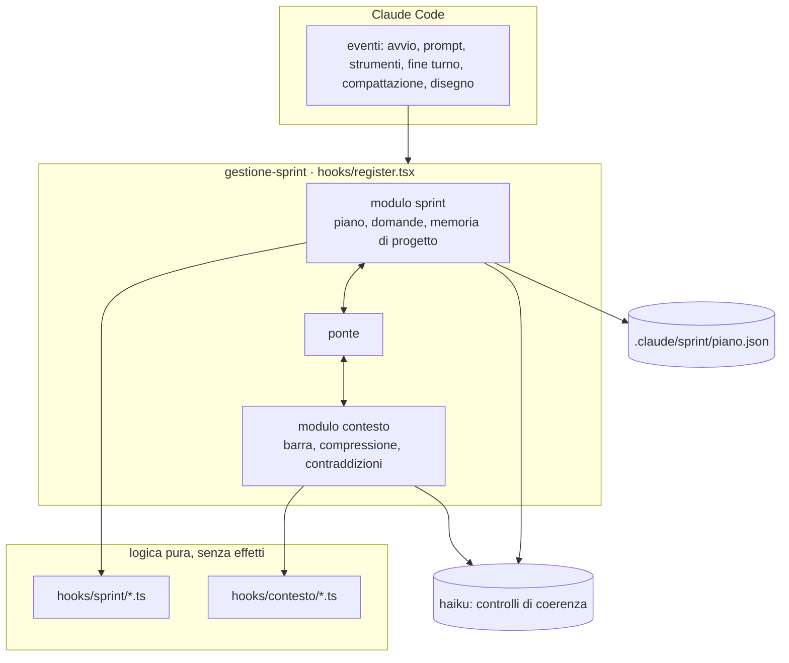
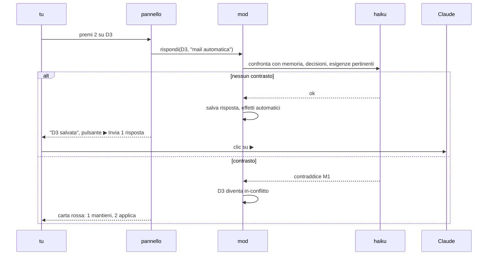
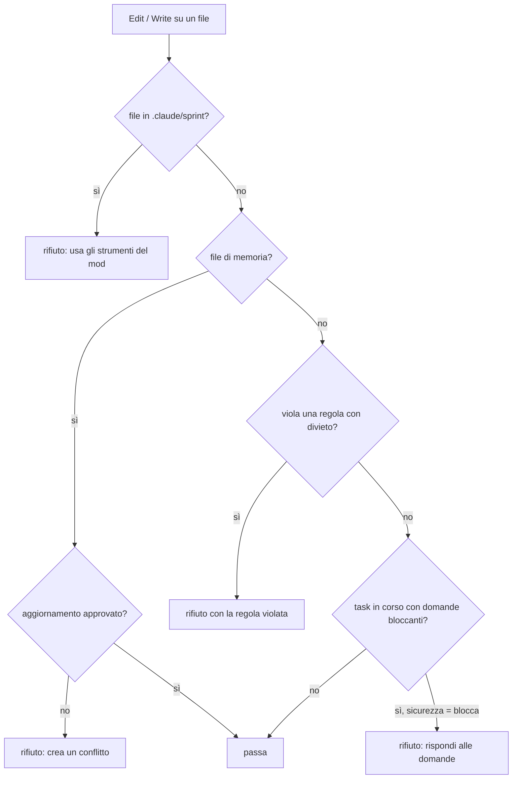

# Architettura

Come è fatto il mod e come reagisce agli eventi di Claude Code.
Per chi vuole capire cosa succede dietro i pulsanti, o modificare il codice.

[← torna al README](../README.md) · [sviluppo](sviluppo.md)

---

## Indice

- [Vista d'insieme](#vista-dinsieme)
- [I due moduli e il ponte](#i-due-moduli-e-il-ponte)
- [File e responsabilità](#file-e-responsabilità)
- [Eventi di Claude Code usati](#eventi-di-claude-code-usati)
- [Strumenti per Claude](#strumenti-per-claude)
- [Cosa arriva al modello](#cosa-arriva-al-modello)
- [Flusso di una risposta](#flusso-di-una-risposta)
- [Flusso di una modifica al codice](#flusso-di-una-modifica-al-codice)
- [Controlli di qualità](#controlli-di-qualità)
- [Definition of ready](#definition-of-ready)
- [La prossima mossa](#la-prossima-mossa)
- [Principi](#principi)

---

## Vista d'insieme



Due livelli:

| livello | dove | cosa fa |
| --- | --- | --- |
| **hook** | `hooks/register.tsx` | parla con Claude Code: legge e scrive file, disegna, registra strumenti e comandi |
| **logica pura** | `hooks/sprint/`, `hooks/contesto/` | funzioni senza effetti: dato un piano, restituiscono un piano nuovo o un testo; facili da testare |

Tutti i hook stanno in un solo file perché il validatore di Claude Code non segue l'oggetto `$` attraverso gli import.

---

## I due moduli e il ponte

| modulo | si occupa di |
| --- | --- |
| **sprint** | piano, task, domande, conflitti, fonti di business, memoria di progetto, guardie sul codice, pannello e riga sprint della banda |
| **contesto** | misura del contesto, consigliere con proposte, compressione dell'output, file pesanti e cartelle escluse, credenziali, compattazione verificata, contraddizioni della chat, claude-mem, stack |
| **ponte** | collega le due memorie |

Cosa fa il ponte:

| funzione | effetto |
| --- | --- |
| `memoriaConProgetto` | il controllo delle contraddizioni della chat vede anche le voci di memoria di progetto |
| `soloSessione` | dopo il controllo, le voci di progetto non diventano decisioni della sessione (stanno già nel piano) |
| `sceltaNelPiano` | una scelta fatta in chat su una voce di progetto segue lo stesso percorso del pannello |
| `notaPiano` | le istruzioni di compattazione e il passaggio citano il piano invece di riassumerlo |
| `erroriAperti` | il registro degli errori entra nella definition of done |

Gli eventi che entrambi i moduli usano (avvio, prompt, Edit/Write, Bash, fine turno) sono una sola catena: il modulo contesto chiama per prime o per ultime le funzioni del modulo sprint (`avvioSprint`, `componiSprint`, `inviaSprint`, `scritturaSprint`, `bloccoBashSprint`, `fineTurnoSprint`).
Se una parte fallisce, l'altra continua.

---

## File e responsabilità

| file | contenuto |
| --- | --- |
| `hooks/register.tsx` | sezioni: archivio (lettura e scrittura del piano), ponte, pannello e banda sprint, modulo sprint (comandi, strumenti, guardie), modulo contesto, punto d'ingresso |
| `hooks/sprint/logic.ts` | applicazione delle modifiche, risposte, conflitti, analisi d'impatto, ipotesi, riepilogo, velocità, viste testuali per il modello, SPRINT.md |
| `hooks/sprint/memoria.ts` | file di memoria e di metodo da cercare, testi per la verifica con haiku, lettura degli esiti, deriva dei file |
| `hooks/sprint/qualita.ts` | controlli di qualità, punteggio, definition of ready, criteri vaghi |
| `hooks/sprint/prompts.ts` | testi che il mod invia a Claude: analisi, business, procedi, risposte, memoria, qualità, chiusura |
| `hooks/contesto/advisor.ts` | proposte del consigliere e loro pulsanti |
| `hooks/contesto/compress.ts` | compressione dell'output dei comandi |
| `hooks/contesto/conflicts.ts` | memoria della sessione e contraddizioni |
| `hooks/contesto/ledger.ts` | registro: file modificati, errori aperti, richieste |
| `hooks/contesto/meter.ts` | barra e colori |
| `hooks/contesto/stack.ts` | profili Laravel, PHP, Python: cartelle, file pesanti, suggerimenti |
| `hooks/contesto/laravel.ts`, `langchain.ts` | guide per versione |
| `hooks/contesto/mem.ts` | integrazione con claude-mem |
| `hooks/contesto/logic.ts` | regole di lettura, ricerca e comandi |
| `types/index.d.ts` | tipi del piano e dello stato |

---

## Eventi di Claude Code usati

| evento | modulo | cosa fa |
| --- | --- | --- |
| `session.start` | entrambi | riconosce progetto e stack; registra comandi e strumenti; carica il piano; controlla la deriva della memoria; apre il pannello se c'è un piano |
| `prompt.compose` | entrambi | sezione fissa nel system prompt (regole del piano, guida dello stack): non cambia con il piano, così resta in cache |
| `prompt.submit` | entrambi | aggiunge lo stato breve del piano; registra le tue richieste; porta al modello le scelte fatte sulle contraddizioni |
| `tool.call` Read, Glob, Grep | contesto | file pesanti, cartelle generate, credenziali |
| `tool.call` Edit, Write, MultiEdit, NotebookEdit | entrambi | piano protetto, memoria protetta, regole con divieto, task con dubbi aperti |
| `tool.call` Bash | entrambi | scritture da terminale sui file di memoria; credenziali; compressione dell'output |
| `tool.call` strumenti del mod | sprint | `piano_leggi`, `piano_aggiorna`, `task_stato`, `domanda_rispondi`, `fonte_leggi`, `memoria_applicata` |
| `command.run` | entrambi | i comandi `/sprint…` e quelli del contesto |
| `session.measure` | contesto | aggiorna la barra e le proposte |
| `turn.complete` | entrambi | controllo delle contraddizioni a fine turno; compattazione rimandata; il piano si ricarica dal file |
| `session.compact` | contesto | istruzioni di compattazione, verifica del riassunto, nota di continuità |
| `session.end` | sprint | azzera lo stato in memoria |
| `ui.render` AbovePrompt | entrambi | la banda: riga del contesto, riga sprint con pulsanti, proposta del consigliere |
| `ui.render` Pane `sprint` | sprint | il pannello del piano |
| `ui.render` Pane del contesto | contesto | il pannello del contesto |

---

## Strumenti per Claude

| strumento | sempre nel prompt | uso |
| --- | --- | --- |
| `piano_leggi` | sì | legge il piano: `riepilogo`, `sprint`, `memoria`, `business`, `qualita`, `completo` |
| `task_stato` | sì | cambia lo stato di un task, con i controlli di ready e done |
| `piano_aggiorna` | no, si carica su richiesta | aggiunge o migliora sprint, task, domande, memoria, esigenze, rischi, decisioni; unisce per id |
| `fonte_leggi` | no | legge una fonte di business a pezzi di 12000 caratteri |
| `domanda_rispondi` | no | registra una risposta che hai dato in chat |
| `memoria_applicata` | no | segna applicato un aggiornamento di memoria approvato |

Regole fisse di `piano_aggiorna`:

- ciò che non nomini resta com'è;
- sprint e task esistenti non si rinominano né si rimuovono: si annullano con motivo;
- `memoria` accetta solo voci nuove;
- una domanda con `conflittoCon` diventa un conflitto che decidi tu;
- Claude non può scrivere risposte;
- ogni contenuto nuovo passa dalla verifica di coerenza con haiku (se `conflictCheck` è attivo).

---

## Cosa rileva il mod prima dell'analisi

Senza usare il modello, il mod prepara per Claude:

| cosa | da dove | a cosa serve |
| --- | --- | --- |
| file di memoria e di metodo | elenco fisso (CLAUDE.md, AGENTS.md, docs, superpowers, GSD, spec-kit, BMAD…) | sapere cosa leggere |
| dimensione dei file | `fs.stat` | leggere a pezzi quelli oltre 20 KB |
| file nuovi, cambiati, uguali | impronta di ogni file, salvata in `progetto.impronte` | rileggere solo ciò che serve |
| comandi di verifica | `composer.json`, `package.json`, `pyproject.toml`, `pytest.ini`, `phpunit.xml`, `Makefile`, `go.mod`, `Cargo.toml` | criteri di accettazione eseguibili |
| piano già presente | `piano.json` | integrarlo invece di ricrearlo |
| superpowers e claude-mem installati | `claude plugin list`, in sottofondo all'avvio e a ogni analisi | usarli o proporne l'installazione |
| strumenti di claude-mem | elenco degli strumenti, `~/.claude-mem/settings.json` | nomi esatti di `search`, `timeline`, `get_observations`, `save_memory`, `smart_outline`, `smart_unfold` nei testi per Claude |
| nome del progetto | cartella del progetto | filtro `project` nelle ricerche di claude-mem |

Le impronte entrano nel piano alla prima modifica che Claude fa dopo l'analisi: se l'analisi si interrompe prima, la volta dopo i file risultano ancora da leggere.

## claude-mem nel mod

Un solo riconoscimento per tutto il mod: plugin nell'elenco di `claude plugin list`, strumenti MCP visibili, oppure `~/.claude-mem/settings.json`. Quando lo trova, accende insieme guida di sistema, compattazione corta, passaggio salvato in memoria, rimedi per i file grandi e passi di analisi.

| testo per Claude | uso di claude-mem |
| --- | --- |
| analisi | prima dei file, `search` con `limit` 5 e `project`, `timeline` se serve, `get_observations` una volta |
| business | esigenza già discussa o realizzata? |
| qualità | stime da lavori simili |
| esecuzione | lavoro già fatto sul tema del task; `smart_outline` e `smart_unfold` |
| domande sui task | risposta già in memoria? |
| aggiornamenti di memoria | `save_memory` "vecchia → nuova" |
| chiusura dello sprint | `save_memory` con l'esito |

Gerarchia: piano.json, poi CLAUDE.md e i file di memoria, poi claude-mem come storia. Le voci nate da claude-mem hanno fonte `claude-mem #id`, compaiono con ◇ nel pannello e non hanno estratto da verificare.

## Cosa arriva al modello

| dove | cosa | quanto |
| --- | --- | --- |
| system prompt (fisso) | regole del piano e degli strumenti; guida dello stack | poche righe, identiche per tutta la sessione |
| con ogni messaggio | stato breve: task, domande, conflitti, copertura del business, qualità | 2-5 righe |
| su richiesta | `piano_leggi` nel formato che serve | solo ciò che chiede |
| con i pulsanti | un testo guida (analisi, procedi, risposte…) da `prompts.ts` | una volta per azione |

Esempio di stato breve:

```
[piano sprint] 2/6 task · 3 domande (1 bloccanti, 1 conflitti) · business coperto 50%
qualita del piano 82/100
```

---

## Flusso di una risposta



Se haiku non risponde, la risposta viene salvata con l'avviso "verifica non eseguita".

---

## Flusso di una modifica al codice



Per i comandi di terminale il mod riconosce le scritture (`>`, `>>`, `tee`, `sed -i`, `cp`, `mv`, `rm`, `Set-Content`, `Out-File`, `Remove-Item`, `git checkout --`, `git restore`…) sui file di memoria e del piano, anche dentro `powershell -Command`, `cmd /c` e `bash -c`; le sole letture passano.

Modifiche in parallelo: Claude chiama spesso più strumenti insieme. Ogni modifica a `piano.json` (rileggi, cambia, salva) passa in una coda, una alla volta, così nessuna va persa.

---

## Controlli di qualità

Punteggio: 100 meno 10 per ogni problema critico e 3 per ogni avviso.

| controllo | livello |
| --- | --- |
| task senza criteri di accettazione | critico |
| criteri non verificabili ("funziona bene") | avviso |
| task senza stima | avviso |
| stima 8 o più: da spezzare | avviso |
| dipendenza da un task inesistente | critico |
| dipendenza da uno sprint successivo | critico |
| dipendenze circolari | critico |
| task da rivedere | critico |
| task basato su una voce superata o inesistente | critico |
| requisito inesistente | avviso |
| sprint senza obiettivo | avviso |
| sprint con più di 8 task | avviso |
| manca il task finale di verifica dello sprint | avviso |
| sprint completato senza revisione e retrospettiva | avviso |
| esigenza alta non coperta | critico |
| esigenza media o bassa non coperta | avviso |
| fonte di business non analizzata | avviso |
| memoria cambiata fuori dal piano | critico |
| rischio grave senza mitigazione | critico |
| rischio grave senza task di mitigazione | avviso |
| domanda bloccante senza opzioni | avviso |
| ipotesi di Claude da confermare | avviso |
| file letti ma nessuna voce di memoria | avviso |
| dipendenza da un task annullato | critico |
| task completato prima delle sue dipendenze | avviso |
| task completato senza la prova nella nota | avviso |
| obiettivo di sprint non verificabile | avviso |
| più di 2 task in corso nello stesso sprint | avviso |
| sprint avviato con il precedente non completato | avviso |
| punti dello sprint oltre 1,5 volte la velocità | avviso |
| esigenza alta coperta solo nell'ultimo sprint | avviso |
| task che copre un'esigenza superata | avviso |
| voci di memoria senza estratto | avviso (uno solo per tutte) |
| mitigazione affidata a un task inesistente | avviso |
| domanda bloccante senza sprint o task | avviso |
| due domande aperte uguali | avviso |

---

## Definition of ready

Un task può passare a "in corso" solo se i requisiti bloccanti sono soddisfatti:

| requisito | bloccante |
| --- | --- |
| ha criteri di accettazione | sì |
| nessuna domanda bloccante e nessun conflitto con la memoria | sì |
| dipendenze completate | sì |
| non è da rivedere | sì |
| le voci di memoria su cui si basa sono valide | sì |
| criteri verificabili | no, solo avviso |
| stima presente e sotto 8 | no, solo avviso |

Nel dettaglio del task il pannello mostra solo i requisiti che mancano.

---

## La prossima mossa

Il pulsante ▶ della banda e il tasto `x` del pannello usano la stessa funzione, `prossimaMossa`.
Valuta le condizioni in quest'ordine e si ferma alla prima vera:

| ordine | condizione | mossa |
| --- | --- | --- |
| 1 | conflitto aperto | apre la carta del conflitto |
| 2 | sprint completato da chiudere (e nessuna risposta in attesa) | revisione e retrospettiva |
| 3 | risposte date ma non inviate | invia le risposte a Claude |
| 4 | 3 o più ipotesi da confermare | apre la scheda memoria |
| 5 | fonti di business da analizzare | analisi delle fonti |
| 6 | aggiornamenti di memoria approvati | li fa applicare |
| 7 | domande che bloccano il prossimo task | apre la prima domanda |
| 8 | prossimo task non pronto | correzione del piano |
| 9 | prossimo task pronto | esecuzione autonoma |
| 10 | piano completato | nuova analisi per migliorarlo |

---

## Principi

1. **Decidi tu.** Risposte, conflitti e modifiche alla memoria passano sempre da una tua scelta.
2. **Rifiutare con un'alternativa.** Ogni blocco dice al modello cosa fare al posto di ciò che ha tentato.
3. **Mai bloccare il lavoro per un errore del mod.** Se un controllo fallisce, la chiamata passa e il resto continua.
4. **Importare, non riscrivere.** Il piano esistente del progetto si migliora, non si sostituisce.
5. **Pochi token.** Il contesto fisso è breve e stabile; il resto si legge su richiesta.

[← torna al README](../README.md)
