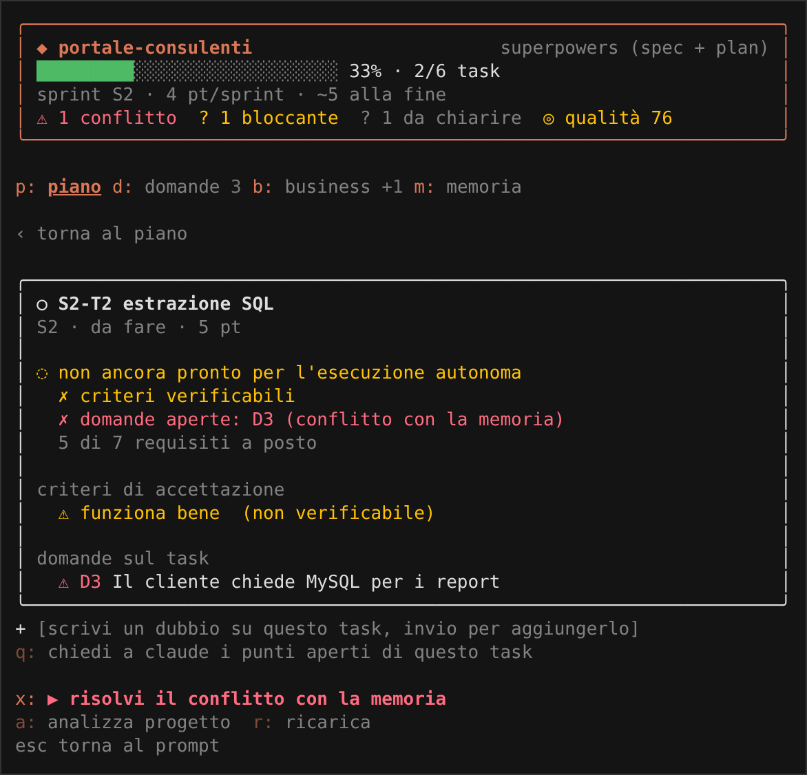

# Guida utente

Percorsi passo passo per usare gestione-sprint con i pulsanti sopra il prompt.
Nessun comando da ricordare: i comandi `/` restano come alternativa.

[← torna al README](../README.md)

---

## Indice

1. [Prima di iniziare](#1-prima-di-iniziare)
2. [Progetto nuovo o senza piano](#2-progetto-nuovo-o-senza-piano)
3. [Progetto già avviato](#3-progetto-già-avviato)
4. [Rispondere alle domande](#4-rispondere-alle-domande)
5. [Incollare email e documenti del business](#5-incollare-email-e-documenti-del-business)
6. [Quando una risposta contraddice la memoria](#6-quando-una-risposta-contraddice-la-memoria)
7. [Lasciare lavorare Claude](#7-lasciare-lavorare-claude)
8. [Chiudere uno sprint](#8-chiudere-uno-sprint)
9. [Confermare le ipotesi di Claude](#9-confermare-le-ipotesi-di-claude)
10. [Aggiungere un dubbio su un task](#10-aggiungere-un-dubbio-su-un-task)
11. [Contesto pieno e sessioni lunghe](#11-contesto-pieno-e-sessioni-lunghe)
12. [Lavorare in squadra o su più PC](#12-lavorare-in-squadra-o-su-più-pc)
13. [Esempio completo](#13-esempio-completo)

---

## 1. Prima di iniziare

| cosa | perché |
| --- | --- |
| mod installato (`install.bat`) | vedi [README](../README.md#installazione) |
| superpowers installato | brainstorming migliore; l'installer lo propone |
| claude-mem installato | memoria tra le sessioni: l'analisi parte da lì e rilegge meno file; l'installer e il pannello lo propongono |
| un CLAUDE.md nel progetto, anche breve | è la memoria da cui il mod parte; senza, il pulsante del consigliere propone di crearlo |
| il progetto in git | il mod legge `git log` per capire cosa è già fatto |

Come leggere la banda:

```
Contesto ███████████████████░░░░░░░░░░░ 62% 124k/200k · liberi 76k  [ Dettagli ]
Sprint   ████████░░░░░░░░░░░░░░░░░░░░░░ 1/4 S2 report mensile  ⚠ 1 conflitto  ? 1 da decidere  ◎ qualità 82
[ ▶ Risolvi il conflitto ]   Domande (3)   Incolla business (1 nuova)   Piano
```

| parte | significato |
| --- | --- |
| `Contesto` | quanto della finestra di contesto è occupato |
| `Sprint` + barra | task completati dello sprint corrente |
| `S2 report mensile` | sprint corrente |
| `⚠` rosso | conflitti con la memoria: vanno decisi per primi |
| `?` giallo | domande bloccanti da decidere |
| `✎` | aggiornamenti di memoria da applicare |
| `◎ qualità` | punteggio del piano, da 0 a 100 |
| `▶ …` | la prossima cosa da fare |

---

## 2. Progetto nuovo o senza piano

1. Apri Claude Code nella cartella del progetto.
2. Nella banda vedi `Sprint  nessun piano per questo progetto`.
3. Clicca **▶ Crea il piano**.

Claude:

- interroga per primo claude-mem, se c'è: decisioni, lavoro già fatto, problemi aperti;
- legge CLAUDE.md, AGENTS.md, README, docs e `git log`, solo per ciò che claude-mem non dice;
- registra ogni fatto vincolante come voce di memoria (M1, M2…) con la riga esatta del file;
- fa il brainstorming con superpowers;
- crea sprint piccoli (3-8 task), con criteri, stime e dipendenze;
- scrive le domande che servono per decidere;
- controlla la qualità del piano e corregge ciò che può.

Alla fine scrive un riepilogo di 6 righe. La banda mostra lo sprint e il pulsante ▶ cambia.

Cosa rende l'analisi precisa:

| il mod passa a Claude | effetto |
| --- | --- |
| i comandi di test del progetto (`php artisan test`, `pytest -q`, `npm run lint`…) | criteri di accettazione che si possono eseguire |
| la dimensione dei file | i file grandi si leggono a pezzi, senza riempire il contesto |
| una lista di punti spesso dimenticati (dati, permessi, errori, prestazioni, privacy, deploy, test…) | meno sorprese a metà sprint |

Se il progetto non ha comandi di test, Claude ti chiede come si prova invece di inventarli.

Vuoi dare indicazioni? Scrivile nel prompt prima di cliccare, oppure usa `/sprint-analizza solo il modulo report, niente app mobile`.

---

## 3. Progetto già avviato

Il mod non riscrive il lavoro già fatto. Riconosce questi metodi:

| metodo | file cercati |
| --- | --- |
| superpowers | `docs/superpowers/specs`, `docs/superpowers/plans` |
| piani in docs | `docs/plans` |
| GSD | `.planning/ROADMAP.md`, `STATE.md`, `REQUIREMENTS.md` |
| spec-kit | `.specify`, `specs` |
| Taskmaster | `.taskmaster/tasks/tasks.json` |
| BMAD | `.bmad-core`, `docs/prd.md`, `docs/stories` |
| markdown semplice | `ROADMAP.md`, `TODO.md`, `SPRINT.md` |
| memory bank | `memory-bank` |

Cosa fa con un piano esistente:

- importa sprint, fasi e storie con **gli stessi id, titoli e ordine** (origine "esistente");
- segna completati i task già fatti, con la prova nella nota;
- migliora solo criteri, dipendenze, stime e task mancanti;
- collega ogni task alla sezione del file originale (`rif`).

Rilanciare l'analisi costa poco: il mod ricorda com'erano i file l'ultima volta e Claude rilegge solo quelli nuovi o cambiati. Se una riga cambiata contraddice una voce di memoria già registrata, nasce un conflitto da decidere.

Nel dettaglio di ogni task vedi l'origine: "esistente", "migliorato" o nuovo, e il riferimento al file originale.

---

## 4. Rispondere alle domande

1. Clicca **Domande (n)** nella banda.
2. Il pannello si apre sulla prima domanda aperta.


| per | fai |
| --- | --- |
| scegliere un'opzione | premi `1`-`9` |
| lasciare decidere Claude | premi `0` |
| rispondere a parole | scrivi nel campo e premi invio |
| saltare | premi `s` |
| tornare al prompt | `esc` |

Le risposte si accumulano. Quando hai finito, il pulsante ▶ diventa **Invia n risposte**: cliccalo e Claude aggiorna il piano.

Puoi rispondere anche in chat ("per D3 va bene solo download"): Claude registra la risposta con le tue parole.
Claude non può mai rispondere al posto tuo.

---

## 5. Incollare email e documenti del business

1. Clicca **Incolla business**.
2. Incolla il testo (email, verbale, documento, ticket) e premi invio.
3. Il pulsante ▶ diventa **Analizza 1 fonte**: cliccalo.


Claude:

- divide il testo in esigenze atomiche (F1-E1, F1-E2…) con priorità alta, media o bassa;
- collega ogni esigenza ai task che la coprono, anche su più sprint;
- crea task nuovi se un'esigenza non è coperta;
- se un'esigenza contraddice la memoria, crea un conflitto da decidere.

Utile sapere:

- lo stesso testo incollato due volte non si duplica;
- un file si aggiunge con `/sprint-fonte C:\percorso\email.eml`;
- i testi lunghi vengono letti a pezzi, senza riempire il contesto;
- la copertura del business (percentuale) è in testata del pannello.

---

## 6. Quando una risposta contraddice la memoria

Esempio: il progetto dice "il database è SQL Server", il cliente scrive "usiamo MySQL per i report".

1. Nella banda compare `⚠ 1 conflitto` e il pulsante **▶ Risolvi il conflitto**.
2. Clicca: si apre la carta rossa con le due versioni.
3. Scegli:

| tasto | effetto |
| --- | --- |
| `1` mantieni la memoria | la nuova scelta si scarta; la memoria resta com'è |
| `2` applica la nuova scelta | la vecchia voce diventa "superata"; nasce un aggiornamento di memoria da approvare; i task che la usavano diventano "da rivedere" |

Finché non scegli, i task collegati restano bloccati e Claude non tocca il codice.

Se scegli `2`, il pulsante ▶ diventa poi **Aggiorna la memoria**: Claude modifica CLAUDE.md (o il file indicato) solo per quella voce approvata.

Lo stesso controllo vale per ciò che scrivi in chat e per le modifiche che Claude fa al piano.

---

## 7. Lasciare lavorare Claude

Quando non ci sono dubbi aperti, il pulsante ▶ dice **Procedi da S2-T1**.

Claude:

- esegue fino a 3 task pronti (opzione `taskPerGiro`);
- per ogni task verifica i criteri (test, comando, output atteso);
- segna completato solo con la prova nella nota;
- si ferma se incontra un dubbio e lo trasforma in domanda.

Se il prossimo task non è pronto, il pulsante dice **Prepara S2-T1**: Claude corregge il piano (criteri, stime, dipendenze) prima di scrivere codice.

Cosa blocca il mod durante il lavoro:

| situazione | effetto |
| --- | --- |
| task in corso con domande bloccanti | niente modifiche al codice |
| modifica che viola una regola con divieto (es. `mysql_query`) | modifica rifiutata, con il motivo |
| modifica diretta a CLAUDE.md o altri file di memoria | rifiutata, salvo aggiornamenti approvati |
| modifica a `piano.json` fuori dagli strumenti del mod | rifiutata |

Con `sicurezza` = `avvisa` i dubbi aperti vengono solo segnalati.

---

## 8. Chiudere uno sprint

Quando tutti i task di uno sprint sono completati, il pulsante ▶ dice **Chiudi lo sprint S1**.

Claude:

- verifica che l'obiettivo dello sprint sia raggiunto;
- controlla le esigenze di business coperte;
- ti dice cosa provare a mano;
- registra al massimo 3 lezioni come voci di memoria;
- segna lo sprint come chiuso.

La velocità (punti per sprint) e la stima degli sprint rimanenti si aggiornano in testata del pannello.

---

## 9. Confermare le ipotesi di Claude

Quando Claude decide qualcosa da solo, la registra come **ipotesi** (decisione con fonte "analisi").

1. Apri il pannello, scheda **memoria** (`m`).
2. Per ogni ipotesi: **✓ confermo** oppure **✗ non è così**.


Se respingi un'ipotesi, diventa una domanda e i task collegati vanno rivisti.
Con 3 o più ipotesi in attesa, il pulsante ▶ te lo ricorda.

---

## 10. Aggiungere un dubbio su un task

1. Clicca **Piano**, poi il task.
2. Nel dettaglio vedi cosa manca per partire e i criteri non verificabili.
3. Scrivi il dubbio nel campo "scrivi un dubbio su questo task" e premi invio.



Il dubbio diventa una domanda bloccante su quel task.
Con `q` chiedi a Claude di trovare da solo i punti aperti del task.

---

## 11. Contesto pieno e sessioni lunghe

La riga `Contesto` della banda segue l'occupazione. Il consigliere propone da solo cosa fare, con pulsanti `1`-`3`:

| quando | proposta |
| --- | --- |
| contesto sopra la soglia | **Compatta ora**: riassunto verificato, il piano non viene copiato |
| sessione molto lunga | **Passaggio a sessione nuova**: riepilogo per ripartire |
| progetto senza CLAUDE.md | **Crea CLAUDE.md** |
| contraddizione tra richieste in chat | **Vale la più recente** / **Vale la prima** / **Valgono entrambe** |

Dopo una compattazione Claude rilegge il piano dal file: niente si perde.
Guida completa: [modulo-contesto.md](modulo-contesto.md).

---

## 12. Lavorare in squadra o su più PC

- Metti `.claude/sprint/` in git: piano, domande, memoria e fonti viaggiano con il progetto.
- `SPRINT.md` è la versione leggibile: si può aprire su GitHub e nelle revisioni.
- Un'altra persona con il mod installato vede lo stesso stato e lo stesso pulsante ▶.
- Due persone che modificano il piano insieme possono creare conflitti di merge in `piano.json`: meglio un solo "proprietario" per sprint.

---

## 13. Esempio completo

Progetto: portale per i consulenti, Laravel e SQL Server, già con un CLAUDE.md.

| passo | banda | cosa fai |
| --- | --- | --- |
| 1 | `nessun piano · ▶ Crea il piano` | clic |
| 2 | `S1 accesso e profili 0/2 · ? 2 da decidere · ▶ Rispondi a 2 domande` | clic, rispondi con `1` e `2` |
| 3 | `▶ Invia 2 risposte` | clic |
| 4 | `▶ Procedi da S1-T1` | clic: Claude scrive login e test |
| 5 | `▶ Chiudi lo sprint S1` | clic: revisione e retrospettiva |
| 6 | arriva un'email del cliente | **Incolla business**, incolli, invio |
| 7 | `▶ Analizza 1 fonte` | clic: nasce lo sprint S2 report mensile |
| 8 | `⚠ 1 conflitto · ▶ Risolvi il conflitto` | il cliente chiede MySQL: premi `1`, resta SQL Server |
| 9 | `▶ Procedi da S2-T1` | clic, e così via |

[← torna al README](../README.md)
